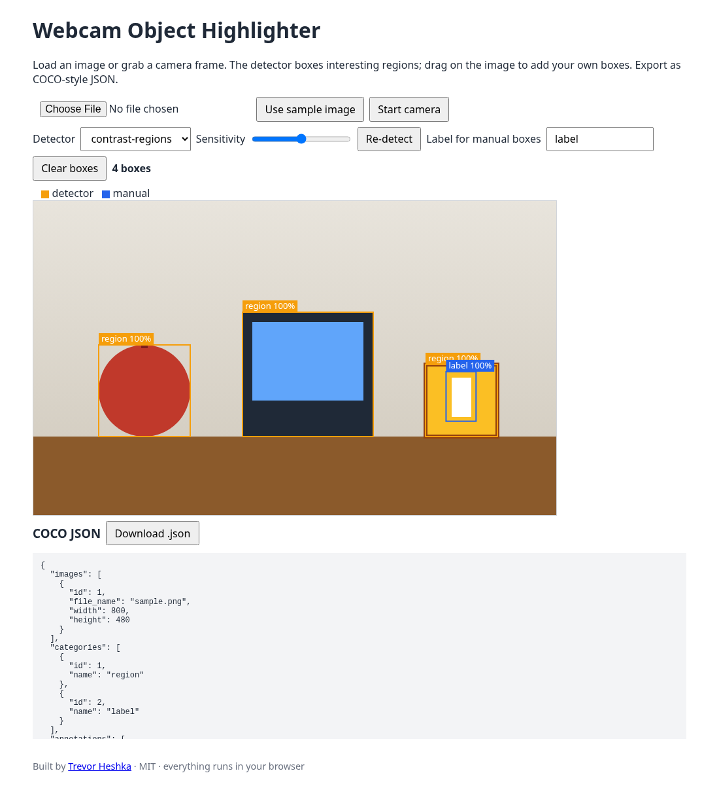
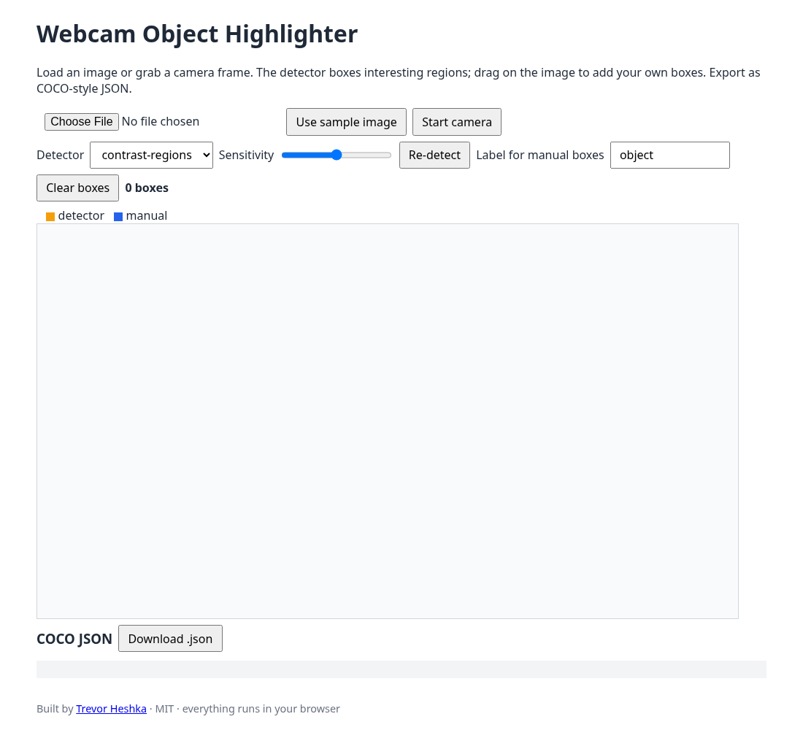

# Webcam Object Highlighter

Built by [Trevor Heshka](https://trevorheshka.com).

A small browser demo. Load an image or grab a webcam frame, and it draws boxes around the objects it finds. Drag to add your own labeled boxes, then export everything as COCO-style JSON. It all runs client-side.



## Prerequisites

- [Node.js](https://nodejs.org) 18 or newer (only for the tiny static server)
- A modern browser (Chrome, Edge, Firefox, Safari)
- A webcam, optional

## Dependencies

None. No `npm install`, no CDN scripts, no model downloads. The built-in detector is about 70 lines of plain JavaScript.

## Install and run

```bash
git clone https://github.com/YardPhantom/webcam-object-highlighter.git
cd webcam-object-highlighter
node server.js
```

Then open <http://localhost:3000>. To use another port, run `PORT=8080 node server.js`.

Browsers only allow camera access on `localhost` or HTTPS. That's why there's a server instead of opening the HTML file directly. Image upload works either way.

## Try it

1. Click **Use sample image**, choose your own file, or click **Start camera** and then **Capture frame**.
2. Orange boxes come from the detector. Use the **Sensitivity** slider to get more or fewer boxes.
3. Type a label, then drag on the image to add a blue manual box.
4. Click **Download .json** to save the annotations (`images`, `categories`, `annotations` with `bbox: [x, y, w, h]`).



## How the detector works

`public/detector.js` ships one detector, `contrast-regions`:

1. Splits the image into 10 px cells and averages each cell's colour.
2. Scores each cell by how different it is from the median colour of its neighbourhood.
3. Ignores cells that match the frame border (walls, tables, sky).
4. Groups neighbouring cells of similar colour and returns one box per group, dropping boxes that sit inside bigger ones.

It's a heuristic, not a trained model: it finds "stuff that stands out" and doesn't know what the stuff is.

### Plug in a real model

A detector is any async function `(ImageData, opts) => [{ x, y, w, h, label, score }]`:

```js
Detectors.register('my-model', async (img) => {
  // e.g. run onnxruntime-web or TensorFlow.js here
  return [{ x: 10, y: 20, w: 100, h: 80, label: 'cat', score: 0.91 }];
});
```

Load your script after `detector.js` in `public/index.html`, and it shows up in the Detector dropdown.

## Files

| File | Purpose |
| --- | --- |
| `server.js` | Static file server, no dependencies |
| `public/index.html` | UI |
| `public/app.js` | Upload, camera, drawing, COCO export |
| `public/detector.js` | Detector registry and built-in detector |
| `public/sample.png` | Sample image |

## License

MIT. This is a demo, not a production detector.
